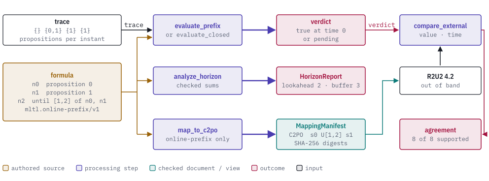
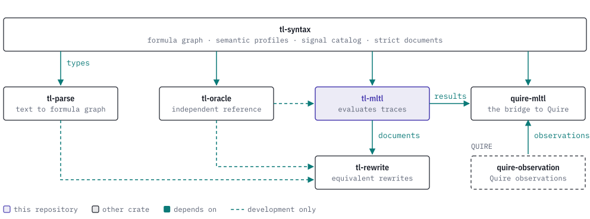

# tl-mltl

[](https://discord.gg/k8DVhuYBR2)
[](#license)
[](Cargo.toml)

tl-mltl is a Rust crate that evaluates Mission-time Linear Temporal Logic (MLTL)
formulas over finite traces, computes how far ahead a formula looks, and maps
formulas to the R2U2 runtime monitor. It builds on the formula and profile types
of [tl-syntax](https://github.com/agent-ix/tl-syntax) and belongs to the TL
family with [tl-parse](https://github.com/agent-ix/tl-parse),
[tl-rewrite](https://github.com/agent-ix/tl-rewrite),
[tl-oracle](https://github.com/agent-ix/tl-oracle) and
[quire-mltl](https://github.com/agent-ix/quire-mltl).

The crate evaluates a closed trace to true or false, evaluates an open prefix to
true, false or pending, reports the checked lookahead and buffer length of a
formula, evaluates bounded past-time formulas over a position history, and emits
C2PO expressions with SHA-256 identities. It compares a verdict from an external
monitor with its own and classifies the pair. It does not parse text, does not
rewrite formulas, does not run R2U2 or C2PO, and does not depend on Quire.

<picture>
  <source media="(prefers-color-scheme: dark)" srcset="docs/images/hero-dark.svg">
  
</picture>

> **Status: prerelease.** The API is not stable. The crate has `publish = false`
> and other TL crates depend on it through git. Registry publication waits for
> the v0.1 assurance review. Results from this crate do not validate, accredit
> or qualify R2U2, another monitor, or a consuming project.

## Usage

This evaluates `F[1,2] p0` over a closed trace, evaluates it over an open
prefix, and reports its horizon. It mirrors `tests/reference.rs`.

```rust
use tl_mltl::{analyze_horizon, evaluate_closed, evaluate_prefix, EvaluationLimits, TruthValue};
use tl_syntax::{Formula, Interval, Node, NodeId, NodeKind, PropositionId, SemanticProfile};

let nodes = [
    Node::new(NodeKind::Proposition { proposition: PropositionId(0) }),
    Node::new(NodeKind::Future {
        interval: Interval::new(1, 2).unwrap(),
        operand: NodeId(0),
    }),
];
let limits = EvaluationLimits::default();

// A closed trace: p0 holds at instant 1, inside the window [1,2].
let closed = Formula::new(SemanticProfile::ClosedTraceV1, NodeId(1), &nodes).unwrap();
let trace = vec![vec![], vec![PropositionId(0)]];
let report = evaluate_closed(closed, "request-ready", &trace, "run-1", limits).unwrap();
assert_eq!(report.verdict, TruthValue::True);

// An open prefix with only instant 0 observed does not decide the formula yet.
let online = Formula::new(SemanticProfile::OnlinePrefixV1, NodeId(1), &nodes).unwrap();
let seen = vec![vec![]];
let open = evaluate_prefix(online, "request-ready", &seen, "run-2", false, limits).unwrap();
assert_eq!(open.verdict, TruthValue::Pending);

// The formula looks 2 instants ahead and needs a buffer of 3.
let horizon = analyze_horizon(closed, "request-ready").unwrap();
assert_eq!((horizon.lookahead, horizon.required_buffer), (2, 3));
```

More examples, including mapping, differential comparison, past-time evaluation
and the command-line tool, are in [docs/examples.md](docs/examples.md).

## Reference

| Module | What it holds |
| --- | --- |
| `future` | `evaluate_closed`, `evaluate_closed_at`, `evaluate_prefix`, `evaluate_prefix_at`, `analyze_horizon`, their `_with_context` forms, `TruthValue`, `EvaluationLimits` and the report types. |
| `past` | `evaluate_past`, `analyze_required_history`, position histories, clock bindings and anchored results for `mltl.origin-complete-history/v1`. |
| `infinite` | Lasso-trace evaluation, finite-prefix safety refutation and safety export for `mltl.infinite-trace/v1` (feature `infinite-trace`). |
| `mapping` | `map_to_c2po`, `map_to_c2po_with_context` and `map_past_to_c2po`, with the mapping manifests. |
| `wire` | Strict readers and canonical writers for the owner documents `tl-mltl.command/v1` and `tl-mltl.trace/v1`, and the schemas of the past-time documents. |
| `clock` | Exact event-position and fixed-sample clock primitives. |
| `differential` (crate root) | `compare_external`, `compare_external_with_context` and the external-verdict and report types. |
| `ci_guard` | Checks that the local `ci` gate set that ran matches the declared set. |

| Binary | What it does |
| --- | --- |
| `tl-mltl` | Reads one `tl-mltl.command/v1` JSON request and prints an evaluation, horizon or mapping record. See [docs/cli.md](docs/cli.md). |
| `ci_guard` | Runs `make ci` and reconciles the gates that completed. |

| Feature | Default | Adds |
| --- | ---: | --- |
| none | yes | Closed and prefix evaluation, horizon analysis, past-time evaluation, mapping and comparison. |
| `infinite-trace` | no | The `infinite` module. |

See [docs/api-reference.md](docs/api-reference.md).

## The TL stack

tl-mltl evaluates formulas over finite traces. It reads the graphs and profiles
defined by tl-syntax. tl-rewrite and quire-mltl build on it, and tl-oracle is a
development-only reference evaluator that tl-mltl tests against. tl-mltl is
independent of Quire. quire-mltl is the one TL crate that connects the family to
Quire.

<picture>
  <source media="(prefers-color-scheme: dark)" srcset="docs/images/tl-stack-dark.svg">
  
</picture>

[docs/how-it-works.md](docs/how-it-works.md) shows where each crate sits in the
text-to-outcome pipeline.

## Building and testing

```sh
make test             # cargo test --all-targets --all-features
make conformance      # replay the shared corpus through the evaluator
make differential     # replay the retained R2U2 4.2 exchange
make cli-conformance  # drive the built CLI over its declared requests
make guarded-ci       # every local gate, with the gate-set check
```

The toolchain is pinned to 1.98.1 in `rust-toolchain.toml`, which is also the
minimum version (`make msrv` checks it). Hosted CI is
manual-only; the checks run locally. Run `make guarded-ci` for the full set,
because a bare `make ci` does not detect a Makefile that suppresses failures.

## Contributing

Read [CONTRIBUTING.md](CONTRIBUTING.md) and [CLA.md](CLA.md). Work is specified
before it is implemented; see [CLAUDE.md](CLAUDE.md) for the workflow and
commands. The change history is in [CHANGELOG.md](CHANGELOG.md). Agent-assisted
contributions go through the same requirements, testing and review gates as
every other contribution.

## License

Licensed under either of [Apache License, Version 2.0](LICENSE-APACHE) or the
[MIT license](LICENSE-MIT) at your option.
