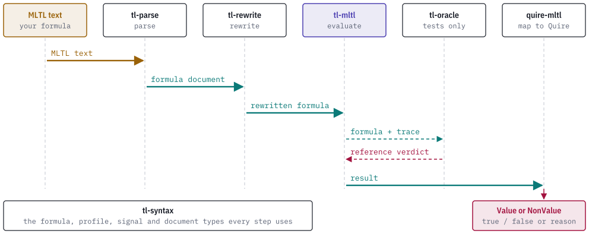

# How it works

## Inputs

An evaluation takes a validated `tl_syntax::Formula`, a caller-chosen formula identity, a trace and a trace identity. A formula is a table of nodes whose operands point to earlier nodes. The formula carries a semantic profile that selects the evaluator.

A trace is a slice of instants. Each instant is a strictly increasing list of the `PropositionId`s that are true there. Every other proposition is false at that instant. A trace that is not strictly ordered is refused with `EvaluationError::TraceNotStrictlyOrdered`.

| Profile | Evaluator | Result |
| --- | --- | --- |
| `mltl.closed-trace/v1` | `evaluate_closed`, `evaluate_closed_at` | `true` or `false` over a complete trace. |
| `mltl.online-prefix/v1` | `evaluate_prefix`, `evaluate_prefix_at` | `true`, `false` or `pending`. |
| `mltl.origin-complete-history/v1` | `evaluate_past` | `true` or `false` at an anchor in a position history. |
| `mltl.infinite-trace/v1` | `infinite::evaluate_lasso` and related (feature `infinite-trace`) | A disposition with evidence, scoped to one trace. |

An evaluator called with a formula of another profile returns `UnsupportedProfile`. It does not reinterpret the formula.

## Evaluation

The future evaluators walk the node table recursively from the root at the verdict time, which is 0 for `evaluate_closed` and `evaluate_prefix` and a caller-chosen instant for the `_at` forms. Three limits in `EvaluationLimits` bound the work: node evaluations (1,000,000 by default), offsets in one interval (100,000) and recursion depth (512). A formula that reaches a limit returns a typed error and no verdict.

The report records the formula and trace identities, the profile, the trace length, whether the trace was closed, the verdict and its time, the last observed instant, the static horizon and the referenced proposition ids. The `_with_stats` forms also return the node evaluations and recursion depth that were used. [semantics.md](semantics.md) defines the verdicts.

## Horizon

`analyze_horizon` computes, without a trace, how many instants after the verdict time a formula can read. The evaluators store the same number in the report as `horizon`. [horizon.md](horizon.md) gives the rule.

## Mapping and comparison

`map_to_c2po` renders an online-prefix formula as a C2PO expression and wraps it in a manifest with the SHA-256 of the input bytes and of the expression. `compare_external` takes a verdict from an external tool and the crate's own report and classifies the pair as agreement, mismatch or non-conclusive. [monitors-interop.md](monitors-interop.md) describes both.

## Contextual results

Each evaluator has a `_with_context` form. It takes a `SignalCatalogDocument` and an optional `RequirementContextDocument` from tl-syntax, checks that every proposition in the formula is bound to a Boolean signal, and returns a version 2 record. The record carries the source revision, the catalog identity and the context, and two digests: one over the request and one over the result.

## Where the crate sits

A formula passes through several crates on its way from text to a Quire outcome. All of them exchange the documents and types defined by tl-syntax.

<picture>
  <source media="(prefers-color-scheme: dark)" srcset="images/pipeline-dark.svg">
  
</picture>

The calling program moves documents from one stage to the next. tl-mltl takes no input from Quire and produces no Quire type. The dependency structure between the crates is in the [README](../README.md#the-tl-stack).
