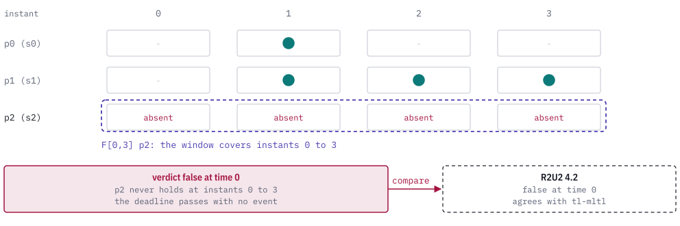

# A worked example: why did the deadline fail?

This walkthrough follows one debugging session through the TL crates. A requirement says a signal must hold within three instants, a recorded trace violates it, and the engineer wants to know why. Each step names the crate that answers one question and what to look at in its output. Every value comes from the retained R2U2 4.2 case `r2u2-future-deadline-v1` in [`corpus/r2u2-v4.2`](../corpus/r2u2-v4.2).

<picture>
  <source media="(prefers-color-scheme: dark)" srcset="images/scenario-sequence-dark.svg">
  
</picture>

## The case

The C2PO input lists six future-time specifications. The third one is the requirement in this walkthrough.

```text
$ cat corpus/r2u2-v4.2/formulas.c2po
INPUT
    s0,s1,s2,s3: bool;

FTSPEC
    F[1,2] s0;
    G[0,2] s1;
    F[0,3] s2;
    ...
```

`F[0,3] s2` reads: signal `s2` must hold at some instant from 0 through 3. The corpus names its signals `s0` to `s3`. In this walkthrough `s2` is the signal the requirement waits for. The signal map ties each name to a trace column.

```text
$ cat corpus/r2u2-v4.2/signals.map
s0:0
s1:1
s2:2
s3:3
```

The recorded trace has four instants. A `1` means the signal holds.

```text
$ cat corpus/r2u2-v4.2/trace.csv
0,0,0,1
1,1,0,0
0,1,0,0
0,1,0,0
```

Column 2, the `s2` column, is `0` in every row. The monitor and the evaluator both report `false`, and the sections below show how to confirm the reason.

The manifest holds the same trace as lists of the true propositions at each instant, `[[], [0, 1], [1], [1]]`. tl-mltl reads that form. The two forms agree for `s0`, `s1` and `s2`. They differ for `s3` at instant 0, which `trace.csv` marks true and the manifest omits. The requirement does not read `s3`.

## 1. Parse the requirement (tl-parse)

tl-parse turns requirement text into a formula document. Its text syntax writes propositions as `p` followed by a number, so `s2` is written `p2`. The `online` profile is `mltl.online-prefix/v1`, the profile the R2U2 adapter requires.

```text
$ printf 'F[0,3] p2' | tl-parse format --profile online -
F[0,3]p2

$ printf 'F[0,3] p2' | tl-parse validate --profile online --json -
{"schema_version":"tl-parse.diagnostics/v1", ... "document":{"schema_version":"tl-syntax.formula/v1","semantic_profile":"mltl.online-prefix/v1","root":1,"nodes":[{"kind":"proposition","proposition":2,"span":{"start":7,"end":9}},{"kind":"future","interval":{"start":0,"end":3},"operand":0,"span":{"start":0,"end":9}}], ...},"diagnostics":[]}
```

Look here:

- The document has two nodes. Node 0 is proposition 2. Node 1 is a `future` node over node 0.
- The interval is `{"start":0,"end":3}`. A deadline written as `[0,3]` and parsed as `[0,2]` would change the verdict, so compare the interval with the requirement.
- `diagnostics` is empty. A refused text returns no document and lists each problem with its byte span.
- `format` prints canonical text. Read it as the requirement. If it does not read back as the requirement, the fault is in the text or the parse, and nothing later can repair it.

## 2. Check the signal bindings (tl-syntax)

tl-syntax defines the formula types, the semantic profiles and the signal catalog that every other crate reads. A catalog declares signals and binds each proposition number to one of them. The catalog below follows `signals.map`: proposition N is signal `sN`.

This program binds the formula to the catalog through `tl_parse::parse_with_context`, and then normalizes it (step 3) and evaluates it with the oracle (step 5). It runs from a scratch crate that depends on tl-syntax, tl-parse, tl-rewrite and tl-oracle by path.

```rust
use std::collections::BTreeMap;
use tl_oracle::{evaluate_closed_trace_v1, Formula, Interval, Limits};
use tl_parse::{parse, parse_with_context, ParseLimits};
use tl_rewrite::{rewrite, RewriteOptions};
use tl_syntax::{
    OwnedSignalDeclaration, PropositionBinding, PropositionId, SemanticProfile,
    SignalCatalogDocument, SignalDomain, SignalId,
};

fn main() {
    // The signal catalog from corpus/r2u2-v4.2/signals.map: sN is signal N, bound to proposition N.
    let signals = (0..4)
        .map(|i| OwnedSignalDeclaration::new(SignalId(i), format!("s{i}"), SignalDomain::Boolean))
        .collect();
    let bindings = (0..4).map(|i| PropositionBinding::new(PropositionId(i), SignalId(i))).collect();
    let catalog = SignalCatalogDocument::new(signals, bindings).unwrap();

    // Step 2: bind the propositions of the formula to the catalog.
    let profile = SemanticProfile::OnlinePrefixV1;
    let bound = parse_with_context("F[0,3] p2", profile, ParseLimits::default(), &catalog, None).unwrap();
    for b in &bound.bindings {
        println!("p{} -> signal s{}", b.proposition.0, b.signal.0);
    }
    let missing = parse_with_context("F[0,3] p9", profile, ParseLimits::default(), &catalog, None);
    println!("p9: {}", missing.unwrap_err());

    // Step 3: normalize under both profiles.
    for profile in [SemanticProfile::OnlinePrefixV1, SemanticProfile::ClosedTraceV1] {
        let document = parse("F[0,3] p2", profile, ParseLimits::default()).document.unwrap();
        let report = rewrite(&document, "deadline", RewriteOptions::default(), "walkthrough");
        println!("{:?}: {:?}, {} steps", profile, report.status, report.steps.len());
    }

    // Step 5: the oracle builds its own formula tree and reads the same trace.
    let trace: [&[u32]; 4] = [&[], &[0, 1], &[1], &[1]];
    let evaluate = |signal: u32| {
        let formula = Formula::Future(
            Interval::Closed { start: 0, end: 3 },
            Box::new(Formula::Atom(PropositionId(signal))),
        );
        let cells: Vec<BTreeMap<PropositionId, bool>> = trace
            .iter()
            .map(|held| BTreeMap::from([(PropositionId(signal), held.contains(&signal))]))
            .collect();
        evaluate_closed_trace_v1(&formula, &cells, 0, Limits::default())
    };
    println!("oracle F[0,3] p2 at 0: {:?}", evaluate(2));
    println!("oracle F[0,3] p1 at 0: {:?}", evaluate(1));
}
```

The output, by step:

```text
p2 -> signal s2
p9: missing signal binding for proposition 9 at 7..9
OnlinePrefixV1: UnsupportedProfile, 0 steps
ClosedTraceV1: Unchanged, 0 steps
oracle F[0,3] p2 at 0: Ok(false)
oracle F[0,3] p1 at 0: Ok(true)
```

Look here:

- `p2 -> signal s2`. The proposition in the formula is bound to the signal the requirement is about. A formula bound to a neighboring signal gives a valid verdict about the wrong thing.
- A proposition with no binding is refused. The second line shows the refusal for `p9`, with the byte span of the proposition in the text.
- A catalog accepts numeric signals, but a proposition can bind only to a Boolean one.

## 3. Normalize the formula (tl-rewrite)

tl-rewrite applies a catalog of semantics-preserving rules and records each step it takes, with evidence that the rewritten formula agrees with the original. A rewrite is useful when a requirement was written in a form that hides its structure, such as a double negation.

The third and fourth lines of the output above show what it does here. The `online-prefix` profile has no rule set, and `rewrite` returns `UnsupportedProfile`. The same formula under the `closed-trace` profile returns `Unchanged` with no steps: `F[0,3] p2` is already a fixed point of the catalog. No rule fired, so there is no equivalence evidence to read, and the formula that tl-mltl evaluates is the formula from step 1.

Look here: a status of `Normalized` lists `steps`, each with a `rule_id`. If a verdict changes after normalization, find the step whose rule produced the change. Here the status is `Unchanged`, so step 3 contributes nothing to the failure.

## 4. Evaluate the formula on the trace (tl-mltl)

tl-mltl evaluates a formula over a trace, analyzes how far ahead the formula reads, and maps the formula to the R2U2 monitor. Its command-line tool takes a JSON request. The three requests for this case share the formula document from step 1 and differ in `operation` and `trace`.

```json
{
  "schemaVersion": "tl-mltl.command/v1",
  "operation": "evaluate",
  "formulaId": "r2u2-future-deadline-v1",
  "formula": {
    "schema_version": "tl-syntax.formula/v1",
    "semantic_profile": "mltl.online-prefix/v1",
    "root": 1,
    "nodes": [
      {"kind": "proposition", "proposition": 2},
      {"kind": "future", "interval": {"start": 0, "end": 3}, "operand": 0}
    ]
  },
  "trace": {
    "schemaVersion": "tl-mltl.trace/v1",
    "traceId": "r2u2-v4.2-trace",
    "closed": true,
    "instants": [[], [0, 1], [1], [1]]
  }
}
```

### The verdict

```text
$ tl-mltl evaluate.json
{
  "formulaId": "r2u2-future-deadline-v1",
  "formulaRoot": 1,
  "horizon": 3,
  "observedThrough": 3,
  "propositionIds": [
    2
  ],
  "schemaVersion": "tl-mltl.evaluation/v1",
  "semanticProfile": "mltl.online-prefix/v1",
  "traceClosed": true,
  "traceId": "r2u2-v4.2-trace",
  "traceLength": 4,
  "verdict": "false",
  "verdictTime": 0
}
```

Look here:

- `verdict` is `false` and `verdictTime` is `0`. The formula is evaluated at instant 0.
- `observedThrough` is 3 and `horizon` is 3. The trace covers the whole window `[0,3]`, so the verdict is final. With fewer instants an open prefix would return `pending` until a witness appears or the window ends.
- `propositionIds` is `[2]`. The verdict depends only on proposition 2. Changes to `s0` or `s1` cannot change it.

### Why it is false

`F[0,3] p2` is true at instant 0 when `p2` holds at some instant from 0 through 3. The timeline shows the window against the recorded values.

<picture>
  <source media="(prefers-color-scheme: dark)" srcset="images/scenario-trace-dark.svg">
  
</picture>

`p2` is absent at instants 0, 1, 2 and 3. No instant inside the window satisfies the operand, so the deadline was missed. That is the evidence for the failure. A trace in which `p2` held at any of those four instants would give `true`. For comparison, `F[0,3] p1` on the same trace is true, because `p1` holds at instant 1 (the second oracle line above).

### The horizon

```text
$ tl-mltl analyze.json
{
  "corpusRevision": "tl-syntax-corpus/v1",
  "formulaId": "r2u2-future-deadline-v1",
  "formulaRoot": 1,
  "lookahead": 3,
  "propagationDelay": 3,
  "requiredBuffer": 4,
  "schemaVersion": "tl-mltl.horizon/v1",
  "semanticProfile": "mltl.online-prefix/v1",
  "unit": "discrete-instants"
}
```

Look here: `lookahead` is 3, so a monitor decides the formula at time 0 once it has seen instant 3, and `requiredBuffer` is 4, the instants it holds. A monitor that stops after instant 2 cannot report a final `false` for this requirement.

### The monitor mapping

```text
$ tl-mltl map_c2po.json
{
  "adapterVersion": "0.3.0",
  "expression": "F[0,3](p2)",
  "externalTool": null,
  "formulaId": "r2u2-future-deadline-v1",
  "inputSha256": "9380acc91a4d7f7758dbe20feaff30c43cd2559ee8acd0a4c1efcb5ee4d21f39",
  "limitation": "mapping evidence does not establish external monitor timing, memory, or qualification",
  "outputSha256": "8e4df135bd3c5dcf2284516bab62f412ad8ebec94b3f385888606a902fab231a",
  "propositionIds": [
    2
  ],
  "schemaVersion": "tl-mltl.monitor-mapping/v1",
  "semanticProfile": "mltl.online-prefix/v1"
}
```

The tool also prints `sourceRevision` and `sourceState`, which identify the build, and they are left out above. `expression` is the C2PO form of the formula. In the corpus the same specification reads `F[0,3] s2` after the signal map renames `p2` to `s2`. R2U2 and C2PO run outside this crate. The retained run of R2U2 4.2 lists a verdict for each specification at each time, and the lines for the third specification are:

```text
$ grep '^2:' corpus/r2u2-v4.2/r2u2.stdout
2:0,F
```

R2U2 reports `F` (false) for specification 2 at time 0. `make differential` replays the retained exchange through `compare_external`. Its row for this case:

```json
{"comparison":"agreement","declaredByCorpusManifest":{"verdict":false,"verdictTime":0},"detail":"truth value and verdict time agree","externalStatus":"conclusive","externalTool":{"name":"r2u2","version":"4.2-release"},"externalValue":false,"externalVerdictTime":0,"referenceVerdict":"false","referenceVerdictTime":0,"schemaVersion":"tl-mltl.differential/v1"}
```

Look here: `comparison` is `agreement`, and both the value and the verdict time match. The corpus has eight supported cases and all eight agree, with no mismatch. When a comparison does not agree, the `comparison` field names the class (`mismatch` or `non_conclusive`) and the next step is the triage below.

## 5. Ask the oracle (tl-oracle)

tl-oracle is a second, independent evaluator. It builds its own formula tree and evaluates each operator from its temporal clause, with no code shared with tl-mltl. tl-mltl uses it only in development tests, as a dev-dependency.

The program in step 2 ran it for this case. The oracle's closed-trace evaluation of `F[0,3] p2` at position 0 returned `Ok(false)`, the same verdict as tl-mltl. The control `F[0,3] p1` returned `Ok(true)`, which shows the oracle can return true on this trace.

Look here: two evaluators that share no code give the same verdict on the same formula and trace. The oracle evaluates the closed-trace semantics, and the trace here covers the whole window, so the closed and online-prefix verdicts coincide. This run compared one formula and one trace. The repository's own test suites run the same comparison over their corpora.

## 6. Record the verdict (quire-mltl)

quire-mltl is the one crate in the family that connects to Quire. It does not evaluate anything itself. It builds a temporal-assessment request from the formula, the trace and six observation views from quire-observation, calls the tl-mltl evaluator, and writes a result document. `contract_ir::map` then turns the result into a Boolean value or a typed reason that no value is available.

For a final `violated` result the map returns `Value { value: false }`, provided the observation views report the required facts as complete and available. If completeness is `incomplete` or `contradicted`, or the results are not available, the map returns a non-value with that name, and `false` is not produced. The observation states are independent of the truth, so a result can say `violated` while the completeness view says `incomplete`.

This walkthrough did not run quire-mltl on the case. Building a request needs the observation fixtures that its own tests construct, and the corpus case has none. The crate's test `tc_084_future_and_past_requests_evaluate_and_strict_read` exercises the same path for another formula and passes.

Look here: the outcome must be `Value false`, and the completeness and availability views in the request must show a complete, available fact population. A `false` that comes with an incomplete population is a non-value, and the assurance record should say so.

## Triage

The walkthrough had no disagreement. Every stage agreed, so the verdict stands and the cause is in the requirement or the recorded trace: here, `s2` never arrived within three instants. This figure covers the case where results differ. It is general guidance for any formula and trace.

<picture>
  <source media="(prefers-color-scheme: dark)" srcset="images/scenario-decision-dark.svg">
  
</picture>

Work down the questions in order. The first answer of no names the stage to inspect.

| Question | Where to look when the answer is no |
| --- | --- |
| Does the formula document read back as the requirement? | The text and the tl-parse diagnostics and document. |
| Is every proposition bound to the intended signal? | The signal catalog and proposition map in tl-syntax. |
| Does the rewritten formula give the original verdict? | The rule named in the tl-rewrite report. Its counterexample trace shows the first difference. |
| Do tl-mltl and tl-oracle return the same verdict? | The evaluator. Shrink the trace to the smallest one that still differs, then work the operator clause by hand to decide which of the two is wrong. |
| Does the monitor verdict match tl-mltl? | The C2PO expression from `map_to_c2po`, then the monitor run. |

## Reproduce

From a clone of this repository:

```sh
cargo build --bin tl-mltl
target/debug/tl-mltl REQUEST.json          # the evaluate, analyze and map_c2po requests above
make differential                          # replays the retained R2U2 exchange
```

tl-parse is built from its own repository with `cargo build --bin tl-parse`. The program in step 2 needs a scratch crate with path dependencies on tl-syntax, tl-parse, tl-rewrite, tl-oracle and tl-mltl, plus a `[patch]` entry for each crate's git source so that all of them use the same checkouts.

The figures are generated by `docs/images/figures.py`. The timeline reads the manifest, the trace and the differential report from `corpus/r2u2-v4.2`.
